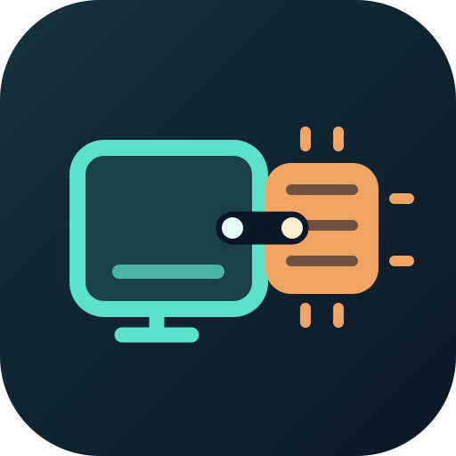
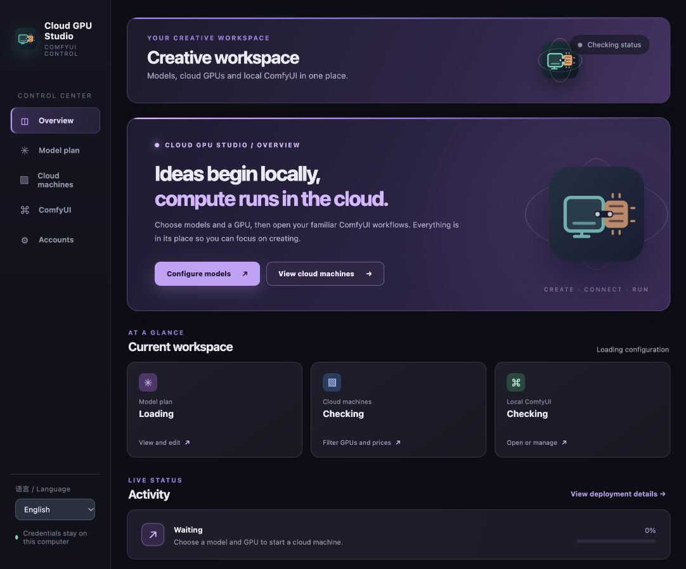

# Cloud GPU Studio

[简体中文](README.zh-CN.md) · English



Cloud GPU Studio is a desktop controller for a local ComfyUI and disposable cloud GPUs. It currently supports RunPod, Vast.ai, and Vultr. The app lets users select a GPU offer and hourly price limit, prepares a remote ComfyUI, downloads a selected model preset, opens an SSH tunnel, and connects a local ComfyUI window. Cloud machines and their temporary storage can be deleted from the app; generated files remain local.

The public presets use model files from the official Comfy-Org MiniMax H3 and Qwen Image 2.1 repositories. File revisions, sizes, and SHA-256 checksums are pinned in `outputs/cloud-gpu-studio/models.lock.json`. Model weights are downloaded directly from Hugging Face when a user starts a machine; they are not included in this repository or the application bundle. The bundled example workflows use general prompts.

## Current scope

- Choose RunPod, Vast.ai, or Vultr and store separate API keys locally. Switch the application language between Simplified Chinese and English from the sidebar.
- Query live GPU offers on each platform, filter by GPU model or an optional hourly price ceiling, and select an exact machine before launch. With no ceiling entered, the selected quote itself becomes the launch price limit. The app rechecks stock and price at launch and asks for a new selection if that offer is no longer eligible. The list keeps at least one quote per eligible GPU model, including Vast.ai A800 where available.
- Choose image and video models independently. The public H3 and Qwen Image 2.1 presets can be combined with compatible local component packs. A public, single-file SD/SDXL image checkpoint can also be selected by its Hugging Face link.
- See deployment stages, model transfer progress, hourly price, account balance, and connection state.
- Watch remote CPU and GPU utilization plus RAM and VRAM usage in live charts sampled about every second after the machine's SSH service is ready. The telemetry SSH connection is reused between samples.
- Open or stop a local ComfyUI window. The bridge nodes run jobs on the cloud ComfyUI over an SSH tunnel and save results under the local ComfyUI output directory. The local panel shows whether the process is running, and **Close ComfyUI** stops it so it does not stay resident in memory.
- Install or repair the local ComfyUI from the official GitHub repository, check for updates, and update it from inside the app. Updating a running local ComfyUI asks first, stops it, then restarts it after the update. Existing workflows, custom nodes, and outputs are preserved.
- Delete the cloud instance and its temporary storage. The app does not terminate machines at a fixed spend or runtime while jobs may still be running; check the hourly price and account balance.
- Optionally enable idle auto-deletion on the Cloud machines page. While the desktop app remains open, it checks both local and cloud ComfyUI running/pending queues. After both stay empty for five minutes, an always-on-top 15-second countdown lets you keep the machine; otherwise the same delete action removes the instance and temporary storage. Unknown queue status or a lost connection prevents auto-deletion. This setting starts off and is saved locally.
- Cancel a deployment while a machine is starting or downloading models without deleting the cloud instance. The machine keeps billing until you explicitly delete it; **Connect to existing machine** resumes installation if it was interrupted.

The **Open ComfyUI** button starts the local ComfyUI independently of the cloud GPU, so workflows and prompts can be edited before provisioning or while the remote machine starts. Cloud bridge nodes require a connected remote GPU when a job is queued.

New RunPod machines allocate a disposable 160 GB workspace volume; Vast.ai instances request a 180 GB disk. Vast.ai's disk also holds the operating system and container image, so it is larger than RunPod's separate data volume. The pinned model sets are about 70 GB for the selected Ref2VA + image models and about 105 GB with both H3 video modes; ComfyUI, the CUDA/PyTorch environment, temporary downloads and outputs fit in the remaining space. Storage pricing depends on the selected provider and offer. During startup, model downloads run alongside the remote Python dependency installation, and the local ComfyUI starts alongside cloud provisioning. The SSH tunnel connects after remote ComfyUI is ready.

The local bridge nodes appear under **Cloud GPU Studio** in ComfyUI. If an older `comfyui_runpod_bridge` installation is also present, it creates a second set of similar nodes; remove only that legacy custom-node link after checking where it points, then restart the local ComfyUI service.

## Development setup

Requirements for development: macOS, Node.js, Rust/Tauri build prerequisites, Python 3, Git, and SSH. The app can install ComfyUI at `~/ComfyUI` through its **Local ComfyUI** panel. This requires a Python 3.10–3.13 executable and downloads the official ComfyUI repository and its Python dependencies. Set `CLOUD_GPU_STUDIO_COMFYUI_DIR` if ComfyUI is elsewhere. Updates use `git pull --ff-only` and stop if tracked ComfyUI files have local edits. The bridge node is linked into `custom_nodes` by the installer.

```sh
npm install
npm run tauri dev
```

Build a macOS app and DMG installer with `npm run tauri build -- --bundles app,dmg`. The application bundle includes the deployment scripts and public model manifest as Tauri resources. `CLOUD_GPU_STUDIO_HOME` can point to a source checkout instead. Runtime configuration is stored under `work/` beside a source checkout, or under `~/.cloud-gpu-studio/` for an installed bundle. `CLOUD_GPU_STUDIO_WORK_DIR` overrides that location.

## User-selected model files

You can edit the H3 and Qwen component URLs in the app's **Custom component pack** panel. The app resolves each public Hugging Face file to an immutable revision and SHA-256 before saving. It does not download model weights until deployment. You can also import an existing pack manually: place a JSON manifest with pinned Hugging Face `repo`, `revision`, `filename`, `destination`, `size`, `sha256`, and `preset` fields in the local runtime directory. Then create `model-overrides.json` there, for example:

```json
{
  "model_manifest": "my-models.lock.json",
  "h3": {
    "unet": "my-h3-model.safetensors",
    "clip": "my-h3-encoder.safetensors",
    "video_vae": "my-h3-video-vae.safetensors",
    "audio_vae": "my-h3-audio-vae.safetensors",
    "lora": "my-video-lora.safetensors"
  },
  "qwen": {
    "unet": "my-image-model.safetensors",
    "clip": "my-image-encoder.safetensors",
    "vae": "my-image-vae.safetensors"
  }
}
```

The `preset` value is `h3` or `qwen`; omit the optional `lora` field when not using one. Select **Custom Qwen component pack** and/or **Custom H3 component pack** in the app. The two slots can also mix a custom pack with an official preset. The app checks that every mapped component is present in the pinned manifest before saving or deploying. Files in the runtime directory are user-owned and excluded from Git. New deployments default to Ref2VA and download its checkpoint before the shared H3 encoder, VAE, and image model; the FL2VA checkpoint and its optional LoRA are downloaded only when **Download first-frame model** is selected. On a running machine, **Download multi-reference model** or **Download first-frame model** verifies the alternate model without interrupting the current mode. Switching modes changes the H3 bridge graph. In Ref2VA, `first_frame` becomes reference image 1, and `reference_2` through `reference_9` are optional further images; refer to them in the prompt as `<Picture 1>`, `<Picture 2>`, etc. Set LoRA strength to 0 in this mode because a LoRA for FL2VA is not assumed compatible with Ref2VA. The current custom encoder and VAE are reused, but that does not guarantee the same output behavior across modes. Model packs with different node types need their own workflow and adapter; a repository link alone does not imply ComfyUI compatibility.

The model selectors describe the deployed cloud files; use the matching Cloud bridge node in a ComfyUI workflow. A single-file SD/SDXL checkpoint uses **Cloud · Hugging Face Checkpoint**. H3 and Qwen Image 2.1 use their respective Cloud nodes. Importing a component pack does not automatically make unrelated model architectures compatible with those nodes.

## Repository safety

The entire `work/` directory, application bundles, build outputs, and dependencies are ignored by Git. API keys and SSH keys are never packaged into the application. Do not add credentials or personal output files elsewhere in the source tree. Before publishing a fork, review the staged files with `git diff --cached --name-only` and run a secret scan.

Model weights and third-party custom nodes are not redistributed here. Check their own terms before downloading or sharing them.

## App updates and releases

The installed app checks the latest GitHub Release on startup. **Accounts → App updates** can check again and install a signed update. This update mechanism applies to the desktop app; the local ComfyUI installation has separate controls on the ComfyUI page. Only a published release is offered as an update; draft releases are for review.

To prepare a release, run `npm run version:set -- 0.2.0`, commit the version change, and run `npm run release:build` on macOS to inspect the signed `.app`, DMG installer, and updater archive. `npm run release:publish` creates and pushes a version tag; GitHub Actions builds a **draft** macOS Apple Silicon release. Review its assets and publish the draft in GitHub to enable automatic update checks. The CI repository must contain `TAURI_SIGNING_PRIVATE_KEY` (the private updater key held by the maintainer) and, if the key has a password, `TAURI_SIGNING_PRIVATE_KEY_PASSWORD`. The public verification key is in `src-tauri/tauri.conf.json`. Never commit, chat, or publish the private key. Losing it prevents existing installations from accepting future updates. This first release pipeline targets macOS Apple Silicon; Windows, Linux, and Intel macOS have not been validated.

The app uses ad-hoc macOS signing in CI. A broadly distributed macOS app should also receive an Apple Developer ID signature and notarization before a public release; otherwise Gatekeeper may interrupt installation.

## License and third parties

Copyright (C) 2026 tian0cai. The original Cloud GPU Studio application and its ComfyUI bridge node are licensed under [GNU GPL version 3 or later](LICENSE). You may use, modify, and sell the application. If you distribute a modified version, you must retain the applicable copyright and license notices, license the covered work under the GPL, and provide the corresponding source code to recipients. Private modifications need not be published. The GPL does not generally govern videos, images, or other output made with the app; model, service, and other third-party terms still apply. See [copyright and attribution](COPYRIGHT.md) and [third-party notices](THIRD-PARTY-NOTICES.md).

Vultr searches Cloud GPU plans and single-GPU GH200 Bare Metal plans. Only plans that the API marks as on-demand deployable and available in a region are selectable. The current GH200 catalog price alone does not imply deployability. Vultr uses a GPU-enabled Ubuntu image with a plan-included disk of at least 160 GB. The app checks the selected plan in the selected region immediately before creation. Add a Vultr API key in Accounts before querying offers. Live provisioning requires a Vultr account with GPU quota and available credit. Vultr machines are deleted only when both their instance ID and unique app-created label match the local deployment record; other Vultr instances are never selected for deletion. If Vultr offers only 48 GB single GPUs, the app explains why the current 80 GB model preset has no eligible host.
