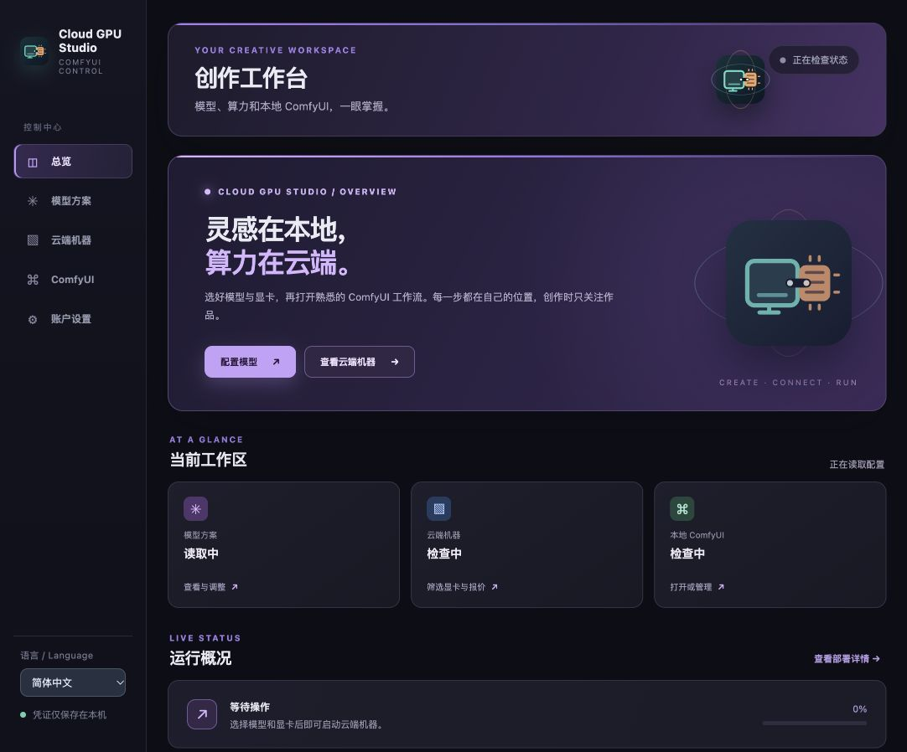

# Cloud GPU Studio

[English](README.md) · 简体中文



Cloud GPU Studio 是连接本地 ComfyUI 与临时云端 GPU 的桌面应用。目前支持 RunPod 和 Vast.ai。你可以分别配置两个平台的 API Key，选择图片及视频模型，查询实时显卡报价，启动或删除机器，并在本地 ComfyUI 编辑和运行工作流。界面语言可在左侧栏切换中文或英文。

## 功能

- 图片与视频模型可以独立选择。内置官方 Qwen Image 2.1 与 MiniMax H3 INT8 配置，也支持兼容的自选组件包与单文件 SD/SDXL 图片 checkpoint。模型文件在部署时由用户直接从 Hugging Face 下载，不随本仓库或应用包分发。
- 在 RunPod 或 Vast.ai 查询符合部署要求的显卡，按型号及可选的每小时价格上限筛选。启动前重新校验库存与报价。
- 先启动本地 ComfyUI 编辑工作流，再按需启动云端机器。云端 ComfyUI 通过 SSH 隧道连接，本地桥接节点把任务送到云端，生成文件保存在本地 ComfyUI 输出目录。
- 查看启动和删除进度、账户余额、小时价格、连接状态，以及云端 CPU、GPU、内存和显存曲线。SSH 就绪后约每秒采样一次。
- 在应用中安装、修复、检查更新或升级本地 ComfyUI；升级前若正在运行，会提示停止并在完成后重启。删除云端实例会删除其临时磁盘，关闭桌面应用不会自动删除云端实例。
- H3 新机器默认下载 Ref2VA 多参考模型；可在运行后按需下载 FL2VA 首帧模型并切换模式。ComfyUI 提供相应的独立工作流模板。

RunPod 新机器预留 180 GB 工作空间，Vast.ai 申请 200 GB 磁盘。磁盘及 GPU 费用按平台报价或计费规则收取。Vast.ai 累计费用达到 $9 时有自动删除保护；RunPod 保留 3 小时保护。使用云机器前请核对报价及账户余额。

## 开发与本地构建

目前验证环境为 macOS。需要 Node.js、Rust/Tauri 构建工具、Python 3、Git 和 SSH。本地 ComfyUI 可通过应用安装在 `~/ComfyUI`；若安装在其他目录，可设置 `CLOUD_GPU_STUDIO_COMFYUI_DIR`。运行时配置保存在源码目录旁的 `work/`，安装版默认使用 `~/.cloud-gpu-studio/`；也可用 `CLOUD_GPU_STUDIO_WORK_DIR` 指定位置。上述运行目录不应提交到 Git。

```sh
npm ci
npm run tauri dev
```

`npm run build` 构建前端；`npm run release:build` 在 macOS 构建签名的应用和更新包。本仓库只打包部署脚本、公开模型清单和示例工作流，不包含模型权重、云平台密钥、个人图片或视频。

## 模型与工作流

在“模型方案”分别选图片和视频模型；自选组件包需填写与现有节点架构匹配的 Hugging Face **文件**链接，应用会锁定版本、文件大小及 SHA-256。单文件 checkpoint 仅面向兼容的 SD/SDXL 图片模型；仅粘贴一个任意模型仓库链接，不能让新架构自动适配现有 ComfyUI 节点。

本地桥接节点位于 ComfyUI 的 **Cloud GPU Studio** 分类。H3 首帧和多参考采用不同主模型和工作流。Ref2VA 中 `first_frame` 是参考图 1，`reference_2` 到 `reference_9` 可以放后续参考图；提示词可使用 `<Picture 1>`、`<Picture 2>` 等指代。不要假设 FL2VA 的 LoRA 适配 Ref2VA。模板文件在 `outputs/cloud-gpu-studio/workflows/`。更多组件包字段及导入示例见 [English README](README.md#user-selected-model-files)。

## 应用升级和发布

安装版启动时检查 GitHub 上已公开的最新 Release。“账户设置 → 应用更新”也可手动检查并安装。更新包由 Tauri 验证签名；本地 ComfyUI 的更新按钮与桌面应用更新分开。

维护者先运行 `npm run version:set -- 0.2.0`，提交版本变更，再运行 `npm run release:check` 与 `npm run release:build`，检查生成的 DMG 安装包和签名更新包。`npm run release:publish` 会创建并推送版本标签；GitHub Actions 构建 **草稿 Release**，检查产物后在 GitHub 手动公开，届时用户才会收到升级提示。CI 需要设置仓库密钥 `TAURI_SIGNING_PRIVATE_KEY`；若私钥有密码，还需要 `TAURI_SIGNING_PRIVATE_KEY_PASSWORD`。私钥只保留在安全位置，绝不能提交、聊天传输或公开。当前发布流程仅验证 macOS Apple Silicon；公开分发前还建议配置 Apple Developer ID 签名及公证。

## 许可

Copyright (C) 2026 tian0cai。Cloud GPU Studio 应用及其 ComfyUI 桥接节点的原创代码采用 [GNU GPL 第 3 版或后续版本](LICENSE)。可以使用、修改，也可以销售本应用；向他人分发修改版时，须保留适用的版权与许可声明，按 GPL 授权受其约束的作品，并向接收者提供对应源码。仅供自己使用的修改不必公开。GPL 通常不约束用应用生成的视频、图片等作品；模型、平台服务及其他第三方条款仍需遵守。详见[版权与来源说明](COPYRIGHT.md)和[第三方声明](THIRD-PARTY-NOTICES.md)。
